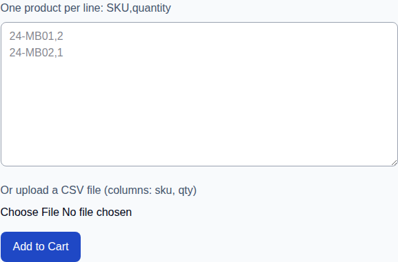

# Quick Order

`mage-os/module-quick-order` (`MageOS_QuickOrder`) — a module for Mage-OS / Magento Open Source.

Adds a storefront page, `/quickorder`, to fill the cart from a list of SKUs.

- One product per line, `SKU,quantity` (separator: comma, semicolon or tab), typed in a text area or uploaded as a CSV file with `sku,qty` columns.
- Unknown SKUs and products that need options are reported one by one; the other lines are added.
- At most 200 SKUs per submission, CSV files up to 1 MB.

No menu link is added: link to `/quickorder` from a CMS block or your navigation.

## Compatibility

Mage-OS 3.6 and 4.x, and Magento Open Source 2.4.9: all share the Magento 2.4.9 base (`magento/framework` ^103.0.9). PHP 8.3 to 8.5. CI runs the check-extension workflow on the currently supported Mage-OS versions (today Mage-OS 3.6.0 with PHP 8.4; Mage-OS 4.0 joins once the check-extension actions know it); developed on Mage-OS 4.0.0 with PHP 8.5. Storefront: Hyvä default theme (1.5) and Luma; Hyvä Checkout and GraphQL are not supported.

## Installation

```bash
composer config repositories.mageos-quick-order vcs https://github.com/mage-os-lab/module-quick-order
composer require mage-os/module-quick-order
bin/magento module:enable MageOS_QuickOrder
bin/magento setup:upgrade
```

## Configuration

No configuration. The page is `/quickorder`; link to it from a CMS block or your navigation.

## Getting started

1. Open `/quickorder` on the storefront.
2. Type one product per line, `SKU,quantity`, or upload a CSV or TXT file with `sku,qty` columns.
3. Click *Add to Cart*: you land on the cart, with a message for each line that could not be added.



## Troubleshooting

- **"Please upload a .csv or .txt file"**: other extensions are refused.
- **A line is reported with an error**: unknown SKU, out of stock, or a product that needs options (configurable, bundle); add those from the product page.

## More

- [CHANGELOG](CHANGELOG.md)
- [Security policy](SECURITY.md)
- [License](LICENSE.txt): Open Software License 3.0. This module contains no code from Adobe Commerce.
